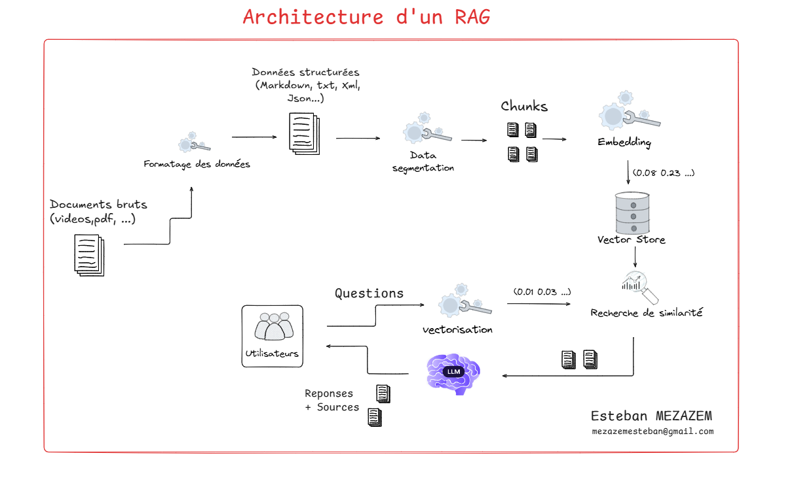

# Exploration RAG-LLM
Exploration RAG et LLM
Projet RAG et LLM réalisé durant ma formation. Exploration de la génération augmentée par récupération pour enrichir le contexte d'un modèle d'intelligence artificielle avec des données personnalisées, appliqué au cas d'usage de la mairie de Triffouillis-sur-Loire.

# Description du Projet
Ce dépôt regroupe une suite d'expérimentations visant à construire un système RAG complet pour traiter les documents administratifs et municipaux. L'objectif est d'extraire le contenu des documents, d'en générer une représentation vectorielle, de visualiser cet espace d'embeddings et de calculer la similarité sémantique pour effectuer une recherche d'information précise.

